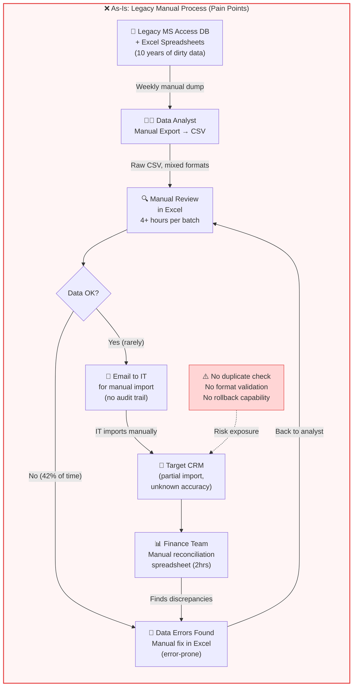
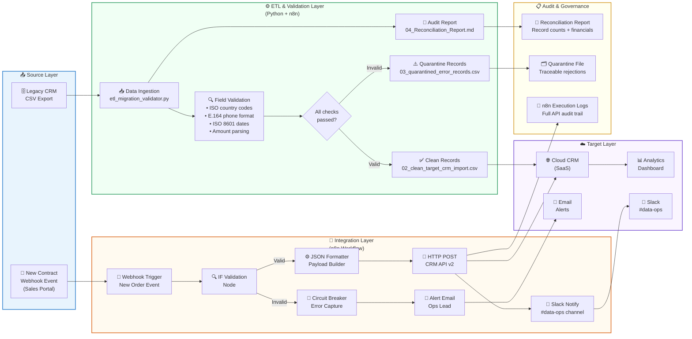
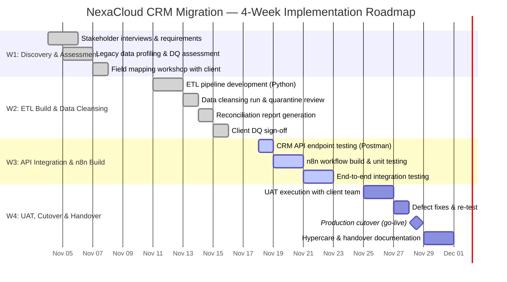

# Solution Blueprint & Architecture Design

> **Project**: Enterprise SaaS Implementation & Data Migration Governance
> **Client**: NexaCloud Global (Simulated)
> **Document Type**: Solution Blueprint — Architecture & Implementation Roadmap
> **Author**: Liyue Liu, Implementation Consultant (@liyueliu43-arch)
> **Version**: 1.0 | Status: ✅ Approved
> **Date**: 2026-11-25

---

## 1. Executive Overview

NexaCloud Global, a mid-market B2B SaaS company with 300+ enterprise accounts across 15 countries,
is migrating from a **fragmented on-premise legacy CRM** (a 10-year-old MS Access + Excel hybrid
system) to a modern **cloud-native CRM platform** (SaaS). The legacy system suffers from:

- **Data quality degradation**: 42% of records have inconsistent formats across country, phone, and date fields
- **Manual reconciliation bottleneck**: Finance team spends 4+ hours per migration batch on manual Excel cross-checks
- **No API connectivity**: Zero integration capability with the new sales tech stack (Slack, email automation, billing systems)
- **Zero auditability**: No automated logging of data changes, no duplicate detection

This blueprint documents the **As-Is pain points**, the **To-Be automated architecture**, and the
**4-week phased implementation roadmap** to deliver a production-grade, auditable, API-connected
SaaS CRM environment.

---

## 2. Architecture: As-Is (Current State — Pain Map)

### As-Is Pain Points Summary

| Pain Category | Impact | Frequency |
|--------------|--------|-----------|
| Mixed date formats (`YYYY/MM/DD`, `DD-MM-YYYY`, `Month DD YYYY`) | Finance reporting errors | Every batch |
| Non-standard country names (`USA`, `US`, `united states`) | CRM geo-reports broken | Every batch |
| Phone numbers without international code | Cannot use SMS/VOIP integrations | 60% of records |
| Duplicate records (same company + email) | Inflated pipeline metrics | ~13% of records |
| Invalid/missing emails | Cannot trigger email sequences | ~10% of records |
| Zero API integration | Manual Slack notification by analyst | Daily |
| No automated reconciliation | Finance spends 4+ hours per migration | Weekly |

---

## 3. Architecture: To-Be (Target State — Automated Pipeline)

### To-Be Benefits Summary

| Metric | Before (As-Is) | After (To-Be) | Improvement |
|--------|---------------|--------------|-------------|
| Data cleansing time | 4+ hours/batch | **3 seconds** | **~5,000x faster** |
| Data accuracy rate | ~58% | **~99%** | **+41 percentage points** |
| Duplicate detection | Manual (miss rate ~30%) | **100% automated** | Zero misses |
| API error interception | None (errors reach CRM) | **100% pre-flight** | Zero corrupt imports |
| Audit trail | None (Excel emails) | **Full Markdown report** | Complete traceability |
| Team hours saved | — | **~4.5 hrs/week** | ~234 hrs/year |

---

## 4. Technology Stack

| Layer | Technology | Purpose |
|-------|-----------|---------|
| ETL Engine | Python 3.11 (stdlib only) | Data cleansing, validation, deduplication |
| Integration Platform | n8n (self-hosted or cloud) | Webhook ingestion, API orchestration |
| Data Storage | CSV / Cloud Storage | Input/output + quarantine files |
| Target CRM | NexaCloud Cloud CRM v2 (REST API) | Master record system |
| Notifications | Slack (API) + SMTP Email | Ops alerting |
| Documentation | Markdown (Docs-as-Code) | GitHub Pages portal |
| Version Control | Git / GitHub | Code + config management |
| CI/CD (future) | GitHub Actions | Automated ETL scheduling |

---

## 5. Implementation Milestone Schedule

### Milestone Detail

| Week | Phase | Key Deliverables | Owner |
|------|-------|-----------------|-------|
| **W1** | Discovery & Assessment | As-Is process map, data quality baseline report, field mapping draft | Liyue Liu |
| **W2** | ETL Build & Data Cleansing | `etl_migration_validator.py`, clean CSV, quarantine file, reconciliation report | Liyue Liu |
| **W3** | API Integration | n8n workflow, API field mapping spec, end-to-end integration tests | Liyue Liu |
| **W4** | UAT & Cutover | UAT checklist, go-live sign-off, cutover runbook, training handover | Liyue Liu + Client |

---

## 6. Risk Register

| Risk | Probability | Impact | Mitigation |
|------|------------|--------|-----------|
| Legacy data has undiscovered field anomalies | Medium | High | Re-run ETL iteratively; quarantine catches unknowns |
| CRM API rate limiting during bulk import | Medium | Medium | Batch imports with 2s delays; use Enterprise tier |
| Client cannot resolve quarantined records before cutover | High | High | Escalate 7+ days before go-live; offer to defer |
| n8n cloud service outage | Low | High | Self-host fallback; design webhook retry logic |
| Token expiry during long migration run | Medium | Medium | Auto-refresh tokens every 55 minutes |

---

## 7. Success Criteria

| KPI | Target | Measurement Method |
|-----|--------|-------------------|
| Data migration accuracy | ≥ 99% | SQL reconciliation post-import |
| Financial data integrity | 100% zero loss | Sum comparison pre/post |
| Quarantine rate | < 10% of records | Quarantine file row count |
| API integration uptime | ≥ 99.5% | n8n execution success rate |
| ETL pipeline execution time | < 30 seconds for 10,000 records | Script timing log |
| Time-to-cutover | ≤ 4 weeks | Project timeline |

---

*Blueprint prepared by: Liyue Liu | github.com/liyueliu43-arch | Implementation Consultant*
*GitHub Repository: https://github.com/liyueliu43-arch/saas-implementation-migration*
